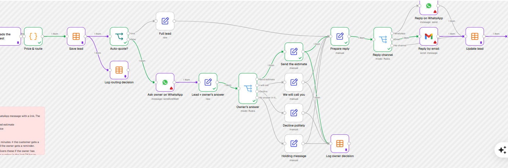
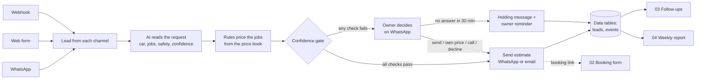

# Garage Quote Agent

**An n8n automation that answers car-repair price requests in seconds: AI reads the message, the garage's own price book sets the price, and the owner approves anything unclear from their own WhatsApp.**

Built for independent repair garages in Greece. WhatsApp is the first customer channel. There is also a web form and a generic webhook.

Demo video (18 seconds, test run with sample data): [kostasxeras.com/projects/garage-quote-agent.html#demo](https://kostasxeras.com/projects/garage-quote-agent.html#demo) · Current version: **v0.2.0** ([changelog](CHANGELOG.md))

## Why this exists

Small garages lose customers at the very first step. Someone asks "how much for front brake pads on a 2015 Yaris?", the mechanic is under a car, and by the time anyone replies the customer has booked elsewhere. Most of these questions are routine and could be answered from a price list. The rest need a mechanic's judgement.

The question I wanted to answer: how much of the first reply can be automated safely, and where must a person stay in control?

## What it does

| Workflow | What it does |
|---|---|
| 01 Lead intake and instant quote | Takes a request from WhatsApp, the web form or a webhook. AI extracts the car, the jobs, safety risks and its own confidence. Rules price the jobs from the price book. Routine requests get an estimate and a booking link automatically. Everything else goes to the owner on WhatsApp, who can send the estimate, set their own price, say they will call, or decline. If the owner does not answer in 30 minutes, the customer gets a holding message and the owner gets a reminder. |
| 02 Booking requests | A booking form linked from every estimate. A one-time token in the link means only real, open estimates can be booked. The owner is told on WhatsApp. |
| 03 Follow-ups | Hourly. Reminds customers who did not book: one reminder on WhatsApp (inside Meta's 24-hour window), up to two by email (only with consent). Then marks the lead lost. |
| 04 Weekly owner report | Monday 08:00 on WhatsApp: leads by channel, share answered automatically, median time to first reply, bookings, lost leads, and requests missing from the price book. |
| 99 Error alerts | If any workflow fails, the owner gets the failed step and a link to the run. |
| 00 Setup | Run once. Creates the data tables with sample settings and a sample price book. |

## How it works

- n8n runs everything: triggers, forms, human-in-the-loop, schedules and error handling. Every step is a standard n8n node except one: the pricing rules live in a single Code node, on purpose ([decision 0008](docs/decisions/0008-n8n-nodes-except-pricing-and-report.md)).
- Claude (Anthropic) only reads and structures the customer's message. It never sets a price.
- n8n Data Tables hold settings, the price book, leads and an event log, all editable without opening a workflow.
- WhatsApp Cloud API reaches customers and is the owner's console too. Gmail reaches web-form customers.

### The confidence gate

An estimate goes out without a person only when all of these hold. Otherwise the owner sees the exact reasons.

- AI confidence ≥ the threshold in settings (default 0.75)
- every requested job is in the price book and allowed for auto-quoting (timing belts and clutches are owner-only by default)
- car make and model are known
- no possible safety issue (smoke, failing brakes, overheating…)
- there is a channel to reply on

## Run it yourself

Step-by-step setup with exact clicks: [docs/setup-guide.md](docs/setup-guide.md). In short: import the six files from `workflows/` into n8n, add five credentials, run 00 Setup, edit the settings table, publish.

## Product documentation

- [Product brief](docs/product-brief.md): users, goals, scope, non-goals
- [Case study](docs/case-study.md): question, approach, findings (to be filled with real pilot data)
- [Decision records](docs/decisions/): the trade-offs behind the design
- [Testing](docs/testing.md): what was tested and how
- [Changelog](CHANGELOG.md) · [Versioning](docs/versioning.md)

## How this was built

I designed the product: the problem, scope, rules, channels and trade-offs in the decision records. I built it with Claude (Anthropic) as my engineering partner, which generated and tested the workflow files from that design. Every node is standard n8n and can be opened, read and changed in the editor.

## Status and limits

- Sample data. The garage ("Demo Garage"), its settings and every price in the price book are illustrative sample values, not market prices.
- No pilot results yet. The case study lists hypotheses with [placeholders] until a real garage runs it.
- Tested against stand-ins. v0.1.0 was tested end to end in a local n8n (2.47.7) with stand-ins for Claude, WhatsApp and email. See [testing](docs/testing.md). The first live run on n8n Cloud may need small fixes.
- Text only. WhatsApp photos and voice notes are ignored in v0.1.
- English replies. The AI understands Greek and Greeklish, but replies are in English.
- WhatsApp follow-ups stop at 24 hours, because later messages need Meta-approved templates.
- Owner alerts need an open WhatsApp window. The owner must message the garage number at least once every 24 hours (a daily "hi"), or Meta blocks the alerts. Templates are the planned fix ([decision 0007](docs/decisions/0007-owner-decisions-on-whatsapp.md)).
- The booking form requests a time. It does not check the garage calendar. The owner confirms.
